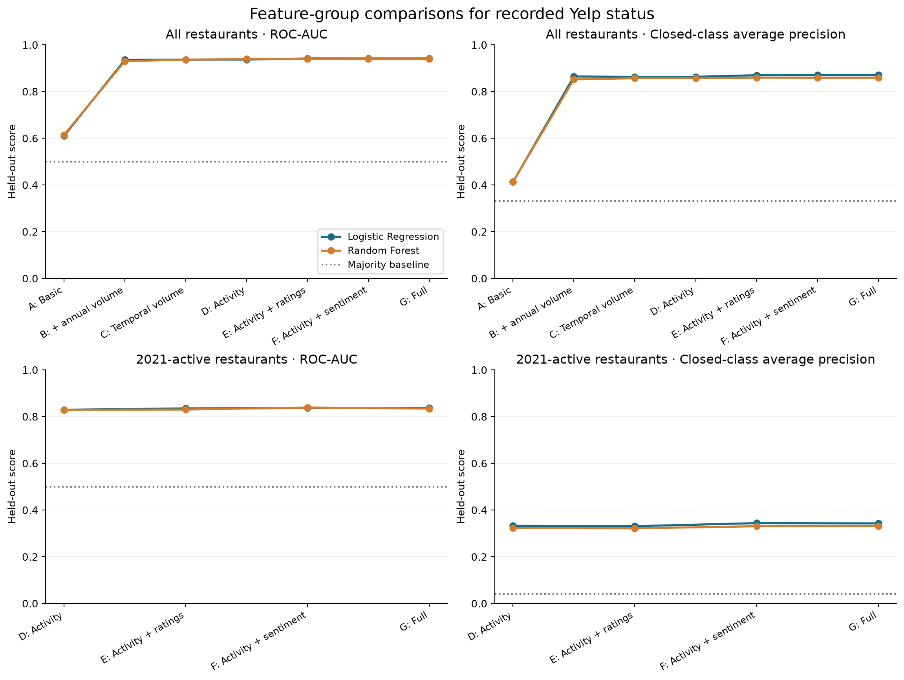
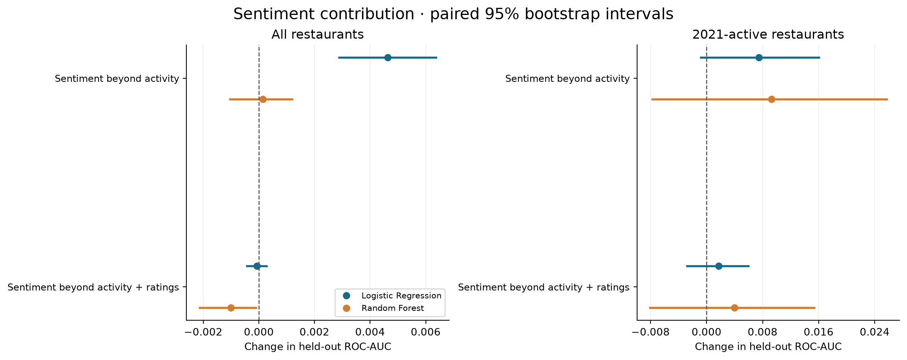

# Yelp recorded-status classification results

Start with the [research report](results_report.md) for the complete RQ1–RQ3 results, statistical comparisons, methods, validation and limitations.

The target is Yelp's recorded `is_open` snapshot status. This analysis does not establish future closure prediction or causality.

## Graphs

- [Review activity and observed sentiment distributions](rq1_distributions.png)
- [Feature-group comparisons: ROC-AUC and closed-class average precision](figures/feature_group_comparison.png)
- [Incremental ROC-AUC with paired 95% bootstrap intervals](figures/incremental_auc.png)
- [Sentiment contributions, including after ratings](figures/sentiment_contribution.png)
- [Full-model ROC and precision–recall curves](figures/classification_curves.png)
- [Full-model confusion matrices](figures/confusion_matrices.png)





## Reproduce the figures

From the repository root:

```bash
python -m pip install -r requirements-status-ablation.txt
python scripts/plot_status_results.py
```

Comparisons, intervals and confusion matrices use the versioned summary CSVs. ROC and precision–recall curves also require locally generated `main/predictions.csv` and `active/predictions.csv`; see the report for the experiment commands to regenerate them. Raw review data and generated business-level datasets remain local. All plots can be regenerated without rescoring sentiment if the saved experiment outputs are present.

`main/` contains the full restaurant sample results; `active/` contains experiments retrained on restaurants with at least one 2021 review. Their class prevalences differ, so average precision should not be compared directly across populations. Bootstrap intervals condition on the fitted models and exclude training-set and population-shift uncertainty.
