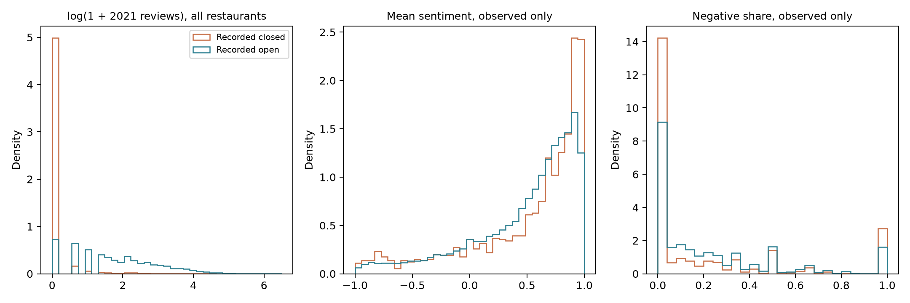
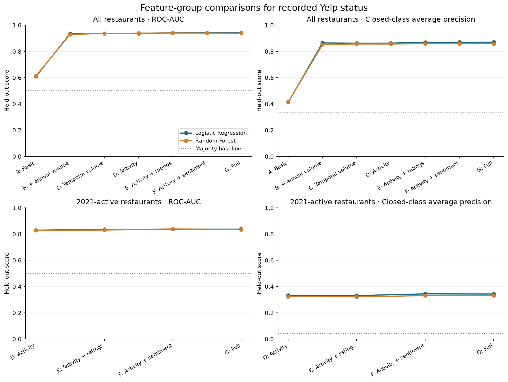
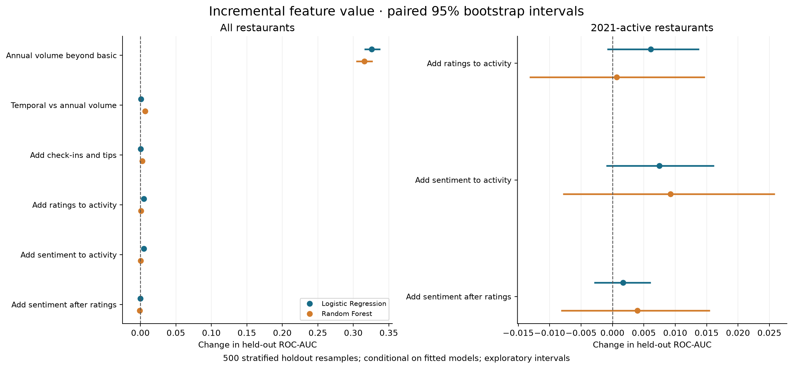
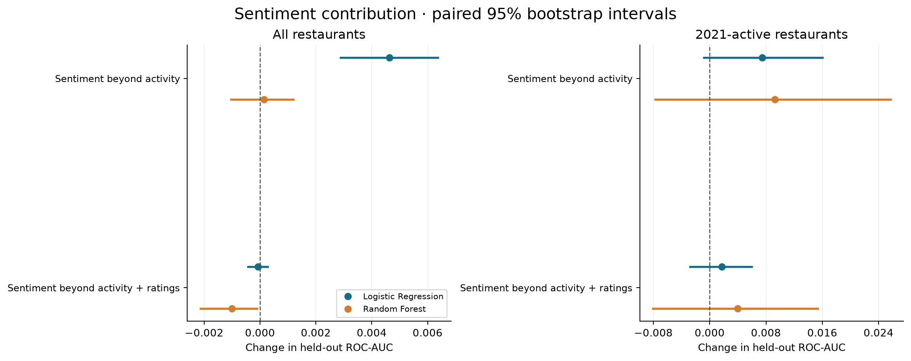
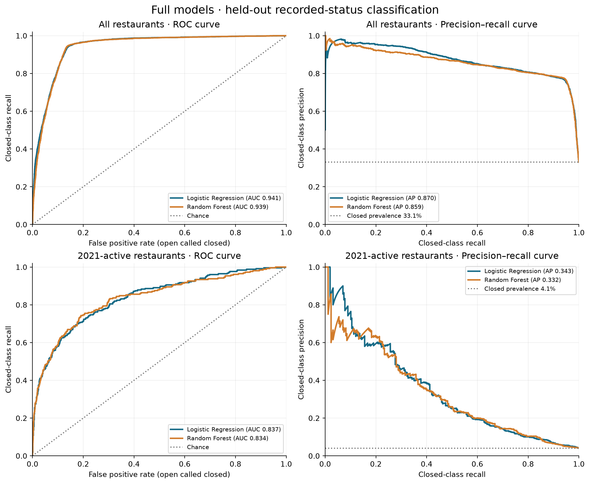
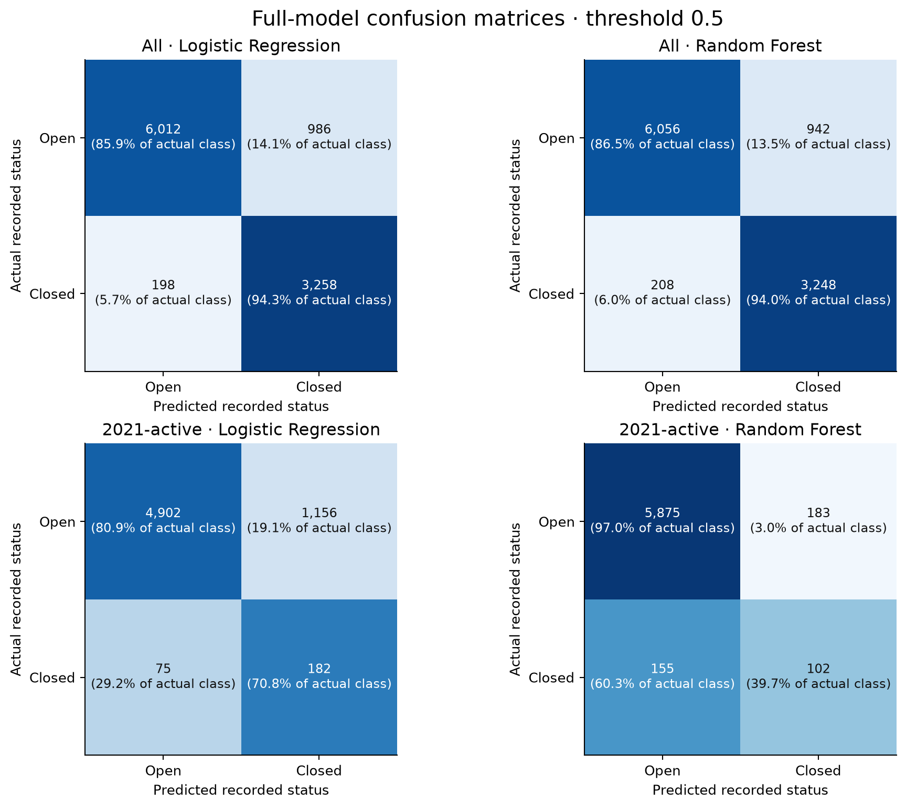

# Yelp recorded-status experiments

Target: Yelp recorded `is_open` snapshot status; closed (`is_open=0`) is the positive class. This study does not predict future closure.

## Existing work and integration

The repository already contained Stage 1 feature construction, review audits, EDA, a logistic activity ablation with deterministic splits, and historical results. `research/` contained a closure-date feasibility pilot. The supplied v2 package contained an unexecuted VADER script, descriptive code, LR/RF pipelines, and preliminary activity results. No cached sentiment output existed. Its VADER streaming design, descriptive summaries, estimator, closed-positive metrics, and feature validation were integrated and extended. The historical `scripts/status_feature_ablation.py` and its saved outputs remain intact; `scripts/recorded_status_experiments.py` is the current RQ1–RQ3 modeling entry point. The supplied package and research pilot were preserved.

Added: sample sentiment standard deviation, half-year means/change, full-stream record validation, one-to-one merge/count reconciliation, controlled sentiment increments, majority baseline, confusion matrices, training CV, independently stratified active-population split, paired bootstrap intervals, statistical comparisons with effect sizes/BH adjustment, figure, tests and this report.

## Data and validation

```json
{
  "valid_reviews": 4724471,
  "scored_reviews_2021": 409047,
  "unique_review_business_ids": 52268,
  "restaurants": 52268,
  "mismatched_counts": 0,
  "missing_sentiment_means": 20693,
  "singleton_std_missing": 4748,
  "vader_version": "3.3.2",
  "negative_threshold": "compound <= -0.05",
  "std": "sample ddof=1; NaN for n<2",
  "review_file_bytes": 1414385835,
  "stage1_sha256": "c5208b55c4233d6d096f727d3cc14696377c7edc40031c693f6d8823b58b6575",
  "review_file_sha256": "189f3a1d3496118c61dd01f2ee7066b51e2f62f1c09df95eba3324cac3eaa5d6"
}
```

The primary gzip was streamed to EOF (including gzip integrity checking); the ZIP was not extracted. All records required valid JSON, sample business IDs, review IDs, parseable dates, nonempty text, and stars in [1,5]. Only 2021 texts were scored. Compound scores were checked in [-1,1]. Annual and both half-year business counts matched Stage 1 exactly. All original columns, row order and target labels were checked after the one-to-one left merge. The original CSV was not rewritten. This run checks business ID uniqueness, not duplicate review IDs; the earlier review audit checked review duplication.

VADER 3.3.2 compound <= -0.05 defines negative sentiment; other scores are nonnegative for this binary share. Aggregates only are saved. No-review sentiment means/shares are NaN. Standard deviation uses ddof=1 (also NaN for one review); change is NaN unless both halves have reviews. VADER is a lexicon baseline whose restaurant-domain validity was not independently adjudicated.

## RQ1: descriptive associations

Recorded-closed restaurants average 0.398 reviews in 2021 versus 11.495 for recorded-open restaurants. Zero-review shares are 92.576% and 13.419%, respectively. Among the 1,283 closed and 30,292 open restaurants with reviews, mean sentiment is 0.5154 versus 0.4841 and negative review share is 0.2057 versus 0.2269. The observed sentiment difference therefore does not support a simple claim that closed restaurants had more negative reviews. These are unweighted business-level averages with different review-count distributions.

Statistics condition on nonmissing observations. Sentiment comparisons concern restaurants with 2021 reviews, not all restaurants. All feature summaries, group sample sizes, medians, standard deviations, zero shares and missingness are in `rq1_descriptive_summary.csv`.

| feature | recorded_status | businesses | non_missing | missing_percent | mean_observed | median_observed | std_observed |
| --- | --- | --- | --- | --- | --- | --- | --- |
| reviews_2021 | closed | 17281 | 17281 | 0.0000 | 0.3981 | 0.0000 | 2.7635 |
| reviews_2021 | open | 34987 | 34987 | 0.0000 | 11.4948 | 5.0000 | 21.5033 |
| avg_review_stars_2021 | closed | 17281 | 1283 | 92.5757 | 3.5875 | 4.0000 | 1.3690 |
| avg_review_stars_2021 | open | 34987 | 30292 | 13.4193 | 3.4355 | 3.7500 | 1.2188 |
| sentiment_mean_2021 | closed | 17281 | 1283 | 92.5757 | 0.5154 | 0.7067 | 0.5036 |
| sentiment_mean_2021 | open | 34987 | 30292 | 13.4193 | 0.4841 | 0.6341 | 0.4563 |
| negative_review_share_2021 | closed | 17281 | 1283 | 92.5757 | 0.2057 | 0.0000 | 0.3275 |
| negative_review_share_2021 | open | 34987 | 30292 | 13.4193 | 0.2269 | 0.1176 | 0.2838 |
| sentiment_change_recent_vs_first_6m | closed | 17281 | 409 | 97.6332 | -0.0756 | -0.0300 | 0.5520 |
| sentiment_change_recent_vs_first_6m | open | 34987 | 22364 | 36.0791 | -0.0243 | -0.0158 | 0.5003 |

Welch tests compare observed means; two-sided Mann–Whitney tests compare distributions (not necessarily medians). Hedges g and signed rank-biserial correlations use closed minus open orientation. BH q-values adjust the Mann–Whitney family across features. Large sample significance alone does not imply useful separation. These exploratory tests assume independent businesses and do not account for shared reviewers, chains or geography.

| feature | hedges_g | rank_biserial_closed_minus_open | mann_whitney_bh_q |
| --- | --- | --- | --- |
| business_stars | -0.0318 | -0.0462 | 0.0000 |
| business_review_count | -0.2724 | -0.2217 | 0.0000 |
| reviews_2021 | -0.6282 | -0.8173 | 0.0000 |
| reviews_first_6m_2021 | -0.5845 | -0.6905 | 0.0000 |
| reviews_recent_6m_2021 | -0.6292 | -0.7377 | 0.0000 |
| reviews_recent_3m_2021 | -0.6139 | -0.6054 | 0.0000 |
| avg_review_stars_2021 | 0.1240 | 0.1129 | 0.0000 |
| rating_change_recent_vs_first_6m | 0.0454 | 0.0233 | 0.4183 |
| all_time_checkins | -0.1981 | -0.1486 | 0.0000 |
| tips_2021 | -0.4924 | -0.3101 | 0.0000 |
| sentiment_mean_2021 | 0.0682 | 0.1058 | 0.0000 |
| sentiment_std_2021 | -0.1188 | -0.0797 | 0.0002 |
| negative_review_share_2021 | -0.0741 | -0.1590 | 0.0000 |
| sentiment_change_recent_vs_first_6m | -0.1022 | -0.0533 | 0.0693 |



## RQ2 and RQ3: common holdout classification

Businesses are sorted by ID before a stratified 80/20 split, random_state=42. Every main experiment uses identical observations. Three-fold shuffled stratified CV is confined to training data. Imputation and scaling are fit inside pipelines within each fold. LR uses log1p count transforms, standardization, balanced class weights and max_iter=2000. RF uses 120 trees, min_samples_leaf=5, balanced_subsample weights and seed 42. Missing numeric values are median imputed with indicators. The fixed decision threshold is 0.5; no holdout tuning or hyperparameter search was performed. Confusion matrices in the CSV use actual/predicted closed as positive (TN=open correctly classified; FP=open called closed; FN=closed called open; TP=closed correctly classified).

A=business stars/lifetime reviews; B=A+annual review volume; C=A+first/second-half volume; D=C+all-time check-ins/tips; E=D+annual review ratings/rating change; F=D+sentiment mean/std/negative share/change; G=D+ratings+sentiment. Thus D is the common activity baseline with basic business characteristics. Annual total and half-year volumes are never combined; sentiment counts are excluded as redundant. First/recent sentiment means are saved but their mean/change representation is used to avoid further redundancy.

| model | feature_group | roc_auc_closed | average_precision_closed | balanced_accuracy | precision_closed | recall_closed | f1_closed |
| --- | --- | --- | --- | --- | --- | --- | --- |
| baseline | majority | 0.5000 | 0.3306 | 0.5000 | 0.0000 | 0.0000 | 0.0000 |
| baseline | zero_review_rule | 0.8967 | 0.7406 | 0.8967 | 0.7719 | 0.9291 | 0.8432 |
| logistic_regression | A_basic | 0.6096 | 0.4129 | 0.5763 | 0.3982 | 0.6013 | 0.4791 |
| random_forest | A_basic | 0.6142 | 0.4137 | 0.5799 | 0.3971 | 0.6386 | 0.4897 |
| logistic_regression | B_volume | 0.9357 | 0.8645 | 0.8957 | 0.7459 | 0.9514 | 0.8362 |
| random_forest | B_volume | 0.9300 | 0.8526 | 0.8991 | 0.7638 | 0.9421 | 0.8436 |
| logistic_regression | C_temporal | 0.9363 | 0.8629 | 0.8829 | 0.7105 | 0.9586 | 0.8161 |
| random_forest | C_temporal | 0.9366 | 0.8568 | 0.9008 | 0.7625 | 0.9473 | 0.8449 |
| logistic_regression | D_activity | 0.9368 | 0.8631 | 0.8843 | 0.7123 | 0.9601 | 0.8178 |
| random_forest | D_activity | 0.9394 | 0.8568 | 0.9017 | 0.7744 | 0.9384 | 0.8485 |
| logistic_regression | E_activity_ratings | 0.9416 | 0.8699 | 0.9003 | 0.7671 | 0.9418 | 0.8456 |
| random_forest | E_activity_ratings | 0.9400 | 0.8592 | 0.9027 | 0.7744 | 0.9407 | 0.8495 |
| logistic_regression | F_activity_sentiment | 0.9414 | 0.8700 | 0.9004 | 0.7676 | 0.9416 | 0.8457 |
| random_forest | F_activity_sentiment | 0.9395 | 0.8587 | 0.9020 | 0.7745 | 0.9389 | 0.8488 |
| logistic_regression | G_full | 0.9415 | 0.8700 | 0.9009 | 0.7677 | 0.9427 | 0.8462 |
| random_forest | G_full | 0.9390 | 0.8588 | 0.9026 | 0.7752 | 0.9398 | 0.8496 |

CV means/standard deviations, confusion counts and exact predictions are retained in `main/`. Full-model entries also provide the RQ2 LR/RF comparison; `main/feature_ablation.csv` contains the RQ3 group results as a separate table from the same run.

### Incremental feature value

Review volume provides the largest increment over business characteristics. Replacing annual volume with temporal counts and adding check-ins/tips yields small, model-dependent increments. For LR, ratings and sentiment each improve AUC over activity alone, but adding sentiment after ratings does not establish further improvement. RF also shows no helpful full-model sentiment increment. Sentiment feature groups include dispersion and missingness indicators, so their increments cannot be attributed solely to the semantic information in review text.

Intervals below are 95% percentile intervals from 500 paired stratified holdout bootstrap resamples with seed 42. They quantify test-sample uncertainty conditional on these fitted models; they omit training-set, label and population-shift uncertainty. These exploratory intervals have no multiplicity adjustment. An interval spanning zero does not establish a contribution. Other metrics are in the incremental CSV.

| model | before | after | metric | delta | ci_low | ci_high |
| --- | --- | --- | --- | --- | --- | --- |
| logistic_regression | A_basic | B_volume | roc_auc_closed | 0.3261 | 0.3154 | 0.3378 |
| logistic_regression | B_volume | C_temporal | roc_auc_closed | 0.0006 | -0.0005 | 0.0017 |
| logistic_regression | C_temporal | D_activity | roc_auc_closed | 0.0005 | -0.0002 | 0.0012 |
| logistic_regression | D_activity | E_activity_ratings | roc_auc_closed | 0.0048 | 0.0032 | 0.0064 |
| logistic_regression | D_activity | F_activity_sentiment | roc_auc_closed | 0.0046 | 0.0028 | 0.0064 |
| logistic_regression | E_activity_ratings | G_full | roc_auc_closed | -0.0001 | -0.0005 | 0.0003 |
| random_forest | A_basic | B_volume | roc_auc_closed | 0.3158 | 0.3040 | 0.3274 |
| random_forest | B_volume | C_temporal | roc_auc_closed | 0.0066 | 0.0043 | 0.0089 |
| random_forest | C_temporal | D_activity | roc_auc_closed | 0.0028 | 0.0005 | 0.0052 |
| random_forest | D_activity | E_activity_ratings | roc_auc_closed | 0.0006 | -0.0002 | 0.0016 |
| random_forest | D_activity | F_activity_sentiment | roc_auc_closed | 0.0001 | -0.0011 | 0.0012 |
| random_forest | E_activity_ratings | G_full | roc_auc_closed | -0.0010 | -0.0022 | -0.0001 |

## Active-review sensitivity

There are 31,575 eligible restaurants (1,283 closed; 30,292 open), with closed prevalence 4.063%. Activity-to-sentiment AUC increments are +0.0075 for LR and +0.0093 for RF; both paired 95% intervals span zero. After ratings, sentiment increments are +0.0017 for LR and +0.0040 for RF, also with intervals spanning zero. This experiment does not establish an incremental sentiment advantage in the active population.

This changes the study population to restaurants with at least one 2021 review. A separate stratified 80/20 split is made within that population, followed by training-only CV and retraining. AP is prevalence dependent and should not be compared directly across populations. The activity baseline includes business characteristics and activity, with no review-derived ratings or sentiment.

```json
{
  "n": 31575,
  "closed": 1283,
  "open": 30292,
  "prevalence_closed": 0.04063341250989707,
  "train_n": 25260,
  "test_n": 6315,
  "seed": 42,
  "folds": 3,
  "trees": 120,
  "groups": {
    "D_activity": [
      "business_stars",
      "business_review_count",
      "reviews_first_6m_2021",
      "reviews_recent_6m_2021",
      "all_time_checkins",
      "tips_2021"
    ],
    "E_activity_ratings": [
      "business_stars",
      "business_review_count",
      "reviews_first_6m_2021",
      "reviews_recent_6m_2021",
      "all_time_checkins",
      "tips_2021",
      "avg_review_stars_2021",
      "rating_change_recent_vs_first_6m"
    ],
    "F_activity_sentiment": [
      "business_stars",
      "business_review_count",
      "reviews_first_6m_2021",
      "reviews_recent_6m_2021",
      "all_time_checkins",
      "tips_2021",
      "sentiment_mean_2021",
      "sentiment_std_2021",
      "negative_review_share_2021",
      "sentiment_change_recent_vs_first_6m"
    ],
    "G_full": [
      "business_stars",
      "business_review_count",
      "reviews_first_6m_2021",
      "reviews_recent_6m_2021",
      "all_time_checkins",
      "tips_2021",
      "avg_review_stars_2021",
      "rating_change_recent_vs_first_6m",
      "sentiment_mean_2021",
      "sentiment_std_2021",
      "negative_review_share_2021",
      "sentiment_change_recent_vs_first_6m"
    ]
  },
  "bootstrap": "stratified paired holdout percentile 95%; conditional on fitted models; no multiplicity adjustment"
}
```

| model | feature_group | roc_auc_closed | average_precision_closed | balanced_accuracy | precision_closed | recall_closed | f1_closed |
| --- | --- | --- | --- | --- | --- | --- | --- |
| baseline | majority | 0.5000 | 0.0407 | 0.5000 | 0.0000 | 0.0000 | 0.0000 |
| baseline | zero_review_rule | 0.5000 | 0.0407 | 0.5000 | 0.0000 | 0.0000 | 0.0000 |
| logistic_regression | D_activity | 0.8290 | 0.3323 | 0.7621 | 0.1245 | 0.7471 | 0.2135 |
| random_forest | D_activity | 0.8295 | 0.3229 | 0.6911 | 0.3186 | 0.4202 | 0.3624 |
| logistic_regression | E_activity_ratings | 0.8351 | 0.3309 | 0.7626 | 0.1374 | 0.7160 | 0.2306 |
| random_forest | E_activity_ratings | 0.8302 | 0.3217 | 0.6824 | 0.3209 | 0.4008 | 0.3564 |
| logistic_regression | F_activity_sentiment | 0.8365 | 0.3439 | 0.7605 | 0.1365 | 0.7121 | 0.2290 |
| random_forest | F_activity_sentiment | 0.8387 | 0.3306 | 0.6866 | 0.3815 | 0.4008 | 0.3909 |
| logistic_regression | G_full | 0.8369 | 0.3428 | 0.7587 | 0.1360 | 0.7082 | 0.2282 |
| random_forest | G_full | 0.8342 | 0.3318 | 0.6833 | 0.3579 | 0.3969 | 0.3764 |

| model | before | after | delta | ci_low | ci_high |
| --- | --- | --- | --- | --- | --- |
| logistic_regression | D_activity | E_activity_ratings | 0.0061 | -0.0008 | 0.0138 |
| logistic_regression | D_activity | F_activity_sentiment | 0.0075 | -0.0010 | 0.0162 |
| logistic_regression | E_activity_ratings | G_full | 0.0017 | -0.0029 | 0.0061 |
| random_forest | D_activity | E_activity_ratings | 0.0007 | -0.0132 | 0.0147 |
| random_forest | D_activity | F_activity_sentiment | 0.0093 | -0.0079 | 0.0258 |
| random_forest | E_activity_ratings | G_full | 0.0040 | -0.0082 | 0.0155 |

## Scientific limits

Yelp is_open is recorded snapshot status; verified closure dates are unavailable for the full sample. Reviews can be posted after actual closure. Business stars, lifetime reviews and all-time check-ins may include information accumulated after 2021. Review inactivity and missing rating/sentiment indicators can encode status timing. Missing sentiment is unavailable evidence, not neutrality. Yelp reviewers may not represent all customers. Random holdout classification accuracy establishes neither future predictive performance nor causality. VADER may misread sarcasm, mixed sentiment or domain language. The active subset is selected on review availability and has different prevalence. Bootstrap intervals do not repair these limitations. The 146 cases where 2021 counts exceed snapshot review totals remain unresolved source inconsistencies; their status breakdown is saved in the activity audit.

## Reproduction

From the repository root (reuse the generated sentiment files unless inputs or scoring code change):

```bash
.venv/bin/python -m pip install -r requirements-status-ablation.txt
# Run this once to rebuild sentiment from the original gzip:
.venv/bin/python -u scripts/build_sentiment_features.py
.venv/bin/python scripts/rq1_descriptive_summary.py --input data/business_features_with_sentiment.csv --output research/status_experiments/rq1_descriptive_summary.csv
.venv/bin/python -u scripts/recorded_status_experiments.py --trees 120 --folds 3 --bootstrap 500
.venv/bin/python scripts/plot_status_results.py
.venv/bin/python scripts/summarize_status_results.py
.venv/bin/python -m unittest discover -s tests -v
.venv/bin/python scripts/validate_status_outputs.py
git status --short
```

## Output inventory

`data/sentiment_features_2021.csv` holds all restaurant aggregates; `data/business_features_with_sentiment.csv` is the preserved Stage 1 table plus sentiment. `research/status_experiments/` holds validation, descriptive statistics, comparisons, figure, activity audit, runtime versions and report; `main/` and `active/` hold model comparisons, predictions, split IDs, feature definitions and paired increments. `validation_checks.json` records independent output checks; `test_results.txt` records actual automated tests. Raw reviews, generated feature datasets and per-business prediction files are kept local; summary CSVs, split IDs, figures and reproducible code are versioned.

## Figures

All figures use saved holdout results. Open and closed mean recorded Yelp status. The active-review population has a separate split and different class prevalence. Confidence intervals describe holdout sampling uncertainty conditional on fitted models.











## Verification outcome

All 10 automated tests passed. Independent cached-output validation passed: source hashes, original Stage 1 columns and labels, aggregate bounds/missingness, count reconciliation, disjoint splits, common holdout IDs and confusion matrices. Experimental settings and runtime versions are recorded alongside the results.
